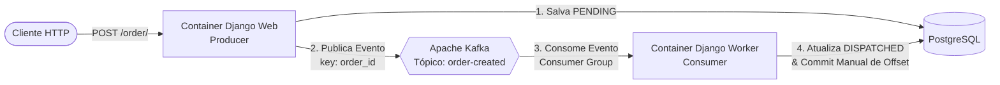

# Kafka Django Async Order Processor

Pipeline assíncrono e desacoplado de recebimento e expedição de pedidos construído com **Python**, **Django**, **Apache Kafka**, **PostgreSQL** e **Docker**.

Este projeto demonstra na prática como desacoplar a ingestão síncrona via HTTP do processamento assíncrono em segundo plano utilizando os princípios de **Arquitetura Orientada a Eventos (EDA)**, garantindo baixa latência na API, escalabilidade horizontal e tolerância a falhas.

---

## Visão Geral da Arquitetura

Em vez de bloquear a requisição HTTP enquanto executa tarefas lentas de expedição (como separação em estoque ou integração logística), a API em Django salva imediatamente o pedido com o status `PENDING` e publica um evento no Apache Kafka. Um serviço worker independente do Django consome esse fluxo de eventos de forma assíncrona e atualiza o status do pedido para `DISPATCHED`.



### Principais Decisões de Arquitetura
* **Base de Código Unificada, Execução Isolada:** Tanto o Producer HTTP (`web`) quanto o Consumer Kafka (`worker`) compartilham os mesmos models do Django ORM e configurações, mas rodam em containers independentes que podem escalar horizontalmente conforme a demanda da fila.
* **Ordenação por Partição (`key=order_id`):** Os eventos são publicados usando o `order_id` como chave de roteamento para garantir a ordem estrita de processamento por pedido.
* **Entrega At-Least-Once (`enable.auto.commit=False`):** O consumidor realiza o commit manual do offset no Kafka somente após a atualização do pedido ser persistida com sucesso no PostgreSQL, evitando perda de mensagens em caso de falha do worker.
* **Kafka em Modo KRaft:** Executa o Apache Kafka 3.8+ sem dependência do Zookeeper para uma infraestrutura mais leve e moderna.

---

## Stack Tecnológica

* **Framework Backend:** Python 3.12, Django 5+
* **Message Broker:** Apache Kafka (modo KRaft) & `confluent-kafka` (`librdkafka`)
* **Banco de Dados:** PostgreSQL 16
* **Infraestrutura e Orquestração:** Docker & Docker Compose

---

## Estrutura do Projeto

```text
kafka-django-async-order-processor/
├── orders/
│   ├── management/
│   │   └── commands/
│   │       └── consume_orders.py   # Worker consumidor do Kafka em segundo plano
│   ├── models.py                   # Model de domínio Order (PENDING -> DISPATCHED)
│   ├── producer.py                 # Serviço Producer com Confluent Kafka
│   ├── urls.py                     # Rotas do app
│   └── views.py                    # Endpoints REST (POST/GET)
├── setup/
│   ├── settings.py                 # Configurações orientadas a variáveis de ambiente
│   └── urls.py                     # Roteamento principal
├── Dockerfile
├── docker-compose.yml              # Orquestração multi-container (web, worker, kafka, db)
└── requirements.txt
```

---

## Como Executar o Projeto

### Pré-requisitos
* [Docker](https://docker.com) e [Docker Compose](https://docker.com) instalados.

### 1. Clone o repositório
```bash
git clone https://github.com
cd kafka-django-async-order-processor
```

### 2. Suba toda a infraestrutura
Construa as imagens e inicie os containers (`postgres`, `kafka`, `web` e `worker`):
```bash
docker compose up --build -d
```

Verifique se os 4 serviços estão em execução:
```bash
docker ps
```

---

## Uso da API e Testes

### 1. Criar um Pedido (`POST /order/`)
Envie um payload JSON para registrar um novo pedido na fila:
```bash
curl -X POST http://localhost:8000/order/ \
  -H "Content-Type: application/json" \
  -d '{
    "customer": "Jorge Alan",
    "product": "MacBook Pro",
    "quantity": 1
  }'
```

**Resposta Imediata (`201 Created`):**
```json
{
  "message": "Order received and queued for dispatch.",
  "order": {
    "id": 1,
    "customer": "Jorge Alan",
    "product": "MacBook Pro",
    "quantity": 1,
    "status": "PENDING"
  }
}
```

### 2. Acompanhar o Processamento Assíncrono
Visualize os logs do worker consumidor em tempo real:
```bash
docker compose logs -f worker
```
*Saída esperada:*
```text
Dispatch Worker started. Listening to topic: order-created...
Processing dispatch for Order #1 (MacBook Pro)...
Order #1 successfully DISPATCHED!
```

### 3. Consultar Status Atualizado (`GET /order/`)
```bash
curl http://localhost:8000/order/
```
O status do pedido no PostgreSQL aparecerá atualizado como `"status": "DISPATCHED"`.

---

## Inspeção do Kafka via Terminal

Para verificar o atraso (*lag*) do grupo de consumidores e os offsets confirmados diretamente no container do broker:
```bash
docker exec -it kafka_broker /opt/kafka/bin/kafka-consumer-groups.sh \
  --bootstrap-server localhost:9092 \
  --describe \
  --group order-dispatch-group
```

---

## Autor

**Jorge Alan** — Engenheiro Full Stack Sênior & AWS Certified Solutions Architect  
[GitHub](https://github.com)
